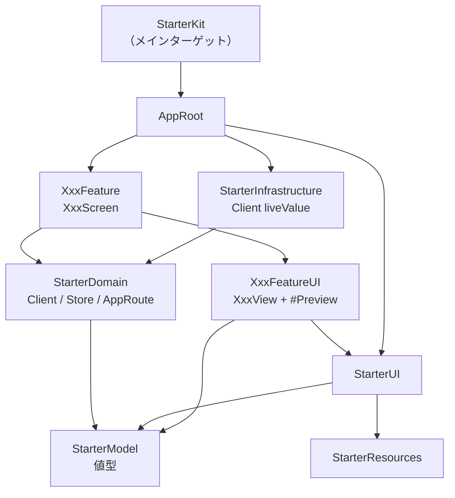

# マルチモジュール構成

> この構成を採用した背景は [ADR-0001](adr/0001-spm-multimodule-structure.md)、
> InfraPackageを分けている経緯は [ADR-0002](adr/0002-split-infra-package.md)、
> UIのモジュールをDomainから切り離している経緯は [ADR-0003](adr/0003-separate-ui-modules-from-domain.md) を参照。

## パッケージ構成

| パッケージ | 置くもの | 外部依存 |
|---|---|---|
| `LocalPackage/` | Model・Domain・UI・Resources・Feature・`StarterSnapshotTestSupport`。ユニットテストはすべてここ | SwiftGenPlugin、Prefire、swift-snapshot-testing（軽いものだけ） |
| `InfraPackage/` | `StarterInfrastructure`・`AppRoot`。`../LocalPackage`をパス依存で参照する | なし（バックエンドが決まったら、そのSDKをここに足す） |
| `ProjectTools/` | SwiftLint（ビルドツールプラグイン）・SwiftFormat | SwiftLint、SwiftFormat |
| `DangerTools/` | Danger Swift（CIだけで使う） | danger-swift、danger-swift-coverage |

LocalPackageに重い外部SDKを持ち込まない。ユニットテスト（`make test-packages-fast`）がそれらを解決・ビルドするようになるため。

InfraPackageにはユニットテストが無く、`make test-packages-fast`ではビルドされない。`StarterDomain`のClientやFeatureの公開APIを変えたら
`make build-infra-package`で追従漏れを確かめる（CIでは`ci_infra_package.yml`が同じことをする）。

## モジュール

| モジュール | 役割 | 依存先 |
|---|---|---|
| `StarterModel` | UIが使う値型のドメインモデル（`Item`・`ItemName`・`DomainError`など）と、そのプレビュー用データ。Store・UseCase・Clientは置かない | なし（最下層） |
| `StarterDomain` | UIが使わない値型・Client（`previewValue`まで）・Store・UseCase・`AppDependencies`・`AppRoute`/`RouteResolver`。`StarterModel`を再公開する | `StarterModel` |
| `StarterResources` | アセット（色・画像）とSwiftGenの生成コード（`StarterColor`・`StarterImage`） | なし |
| `StarterUI` | デザインシステム・共通コンポーネント。Store・Clientには依存させない | `StarterModel`, `StarterResources` |
| `XxxFeatureUI` | UIのみのView（`XxxView` / `XxxContent`）とプレビュー | `StarterModel`, `StarterUI`, `StarterResources` |
| `XxxFeature` | ロジックを持つView（`XxxScreen` / `XxxComponent`）。Storeの呼び出し・シート・遷移 | `XxxFeatureUI`, `StarterDomain`, `StarterUI` |
| `StarterSnapshotTestSupport` | VRTが使うSnapshotTesting・Prefireを提供する。アプリ本体からは依存しない | Prefire, swift-snapshot-testing |
| `StarterInfrastructure`（InfraPackage） | Clientの`liveValue`実装・Service・`AppDependencies.liveValue` | `StarterDomain` |
| `AppRoot`（InfraPackage） | RootView・Storeの組み立て・`RouteResolver`の実体・本番の依存の注入 | `StarterDomain`, `StarterUI`, 全`XxxFeature`, `StarterInfrastructure` |
| `StarterKit`（メインターゲット） | エントリーポイント（`StarterKitApp.swift`）だけ | `AppRoot` |

現在のFeatureは `HomeFeatureUI` / `HomeFeature`（アイテムの一覧と追加。テンプレートのサンプルなので、アプリの最初の機能に置き換える）。



> **ルール:**
> - 重い外部ライブラリへの依存は `InfraPackage` だけが持つ
> - `StarterUI`・`XxxFeatureUI` は `StarterDomain` に依存させない。Storeや`routeResolver`が要るViewは `XxxFeature` 側に置き、UIのみのViewには値とクロージャを渡す
> - Featureモジュール間の直接依存は禁止。Feature間の画面遷移は `RouteResolver` を使う
> - Feature内部の画面遷移は `RouteResolver` を使わず、Feature専用のルートenumと `AppNavigationPath` で管理する

外部ライブラリは `LocalPackage/Package.swift`・`InfraPackage/Package.swift` からだけ参照し、xcodeprojから直接参照しない。
xcodeprojでビルドするときに使われる `Package.resolved` はxcodeproj側の1つだけなので、`scripts/sync-package-resolved.py` でそろえる
（[ADR-0008](adr/0008-sync-package-resolved.md)）。

## Dependency Injection

```
View（XxxScreen）
  ↓ @Environment(ItemStore.self) / @Environment(\.appDependencies.xxxClient)
Store（@MainActor @Observable）
  ↓
Client（クロージャを持つstruct）
  ↓ liveValue（InfraPackage） / previewValue（StarterDomain）
Service（actor）
```

1. Clientはクロージャを持つ`struct`。`previewValue`を`StarterDomain`のClientのファイルに、`liveValue`を`StarterInfrastructure`に定義する
2. `AppDependencies`がClientをまとめ、`\.appDependencies`でEnvironmentに入る。既定値はすべて`previewValue`なので、プレビュー・テストでは何もしなくてよい
3. アプリ本体は`.injectLiveDependencies()`で`AppDependencies.liveValue`を注入する
4. `AppRoot`が`DependenciesInjectLayer`で`AppDependencies`を受け取り、Storeを組み立ててEnvironmentに入れる
5. Viewは使うClientだけをkeypathで取り出す（`.claude/rules/dependency-environment-access.md`）

## Feature間の画面遷移（RouteResolver）

| 遷移の種類 | 方法 |
|---|---|
| Feature間（別モジュールへの遷移） | `StarterDomain`の`AppRoute`に遷移先を足し、`AppRoot`の`RouteResolverInjection.swift`で実体のViewを返す。呼ぶ側は`@Environment(\.routeResolver)`の`resolve(_:)` |
| Feature内（同一モジュール内の遷移） | Feature専用のルートenumと`AppNavigationPath<Route>` |

## Store・UseCaseの置き場所

- Storeは`StarterDomain`に置く。特定の画面に依存しない状態とビジネスルールを持ち、複数のFeatureから使われる。Storeを組み立てるのは`AppRoot`
- 複数のStore・Clientを合成する処理だけ`XxxUseCase`として`StarterDomain`に置く。Store同士は直接依存させない

## 新しいFeatureを足す手順

1. `LocalPackage/Sources/Features/XxxFeatureUI/` と `XxxFeature/` を作り、それぞれに `Localizable.xcstrings` を置く
2. `LocalPackage/Package.swift` に `featureUI(name: "XxxFeatureUI")`・`feature(name: "XxxFeature")` とプロダクトを足す
3. `InfraPackage/Package.swift` の `AppRoot` の依存に `localPackage("XxxFeature")` を足す
4. VRTの対象にするため、次の3か所をそろえる
   - `.prefire.yml` の `testable_imports` に `XxxFeatureUI`
   - `StarterKitVRT.xcodeproj` のテストターゲット（`StarterKitSnapshotTests`）のFrameworksに `XxxFeatureUI`
   - `scripts/affected-modules.py` の `VRT_MODULES` に `XxxFeatureUI`
5. テストが要るなら `LocalPackage/Tests/XxxFeatureTests/` と `.testTarget` を足し、`StarterKit.xctestplan` にも足す
6. このドキュメントの「モジュール」の表を更新する
